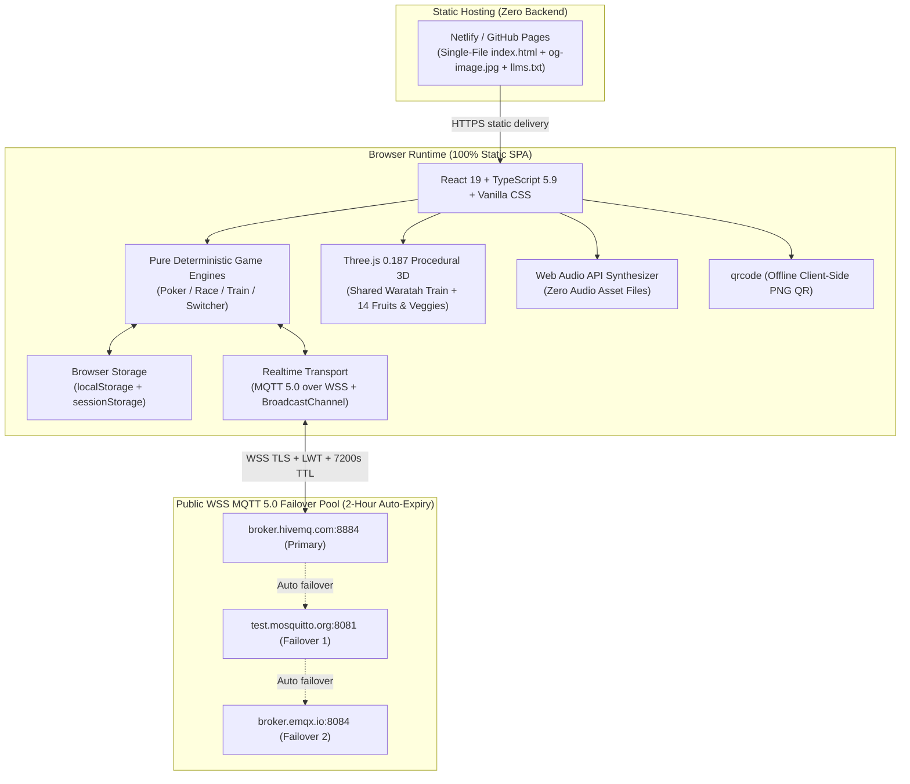

# 🙌 Estimateys

**100% browser-native, zero-database realtime team games & agile rituals.**  
Live at **[estimateys.com](https://estimateys.com)** — no sign-ups, no accounts, no backend servers. Share a link or scannable QR code and play live together on desktop or mobile.

---

## Games Included

| Game | Route | Highlights |
| :--- | :--- | :--- |
| **Planning Poker** | `#/poker` · `#/session/<CODE>` | Basic Fibonacci & T-Shirt decks, clickable Jira/Linear/GitHub round links, sealed votes, synchronized 3-2-1 card reveals, consensus & average summaries |
| **Fruit Race 3D** | `#/race` · `#/race/<CODE>` | 14 sculpted animated 3D fruit & veggie sprinters (100% equal random odds), custom race timer, bulk line-delimited bot rosters, live cheering, mid-race spectator mode, 3D podium |
| **Sydney Express 3D** | `#/train` · `#/train/<CODE>` | Station-to-station icebreaker aboard a 3D Sydney Waratah double-decker across 6 Harbour Line stops (*Central → North Sydney*), 4 curated decks + custom prompts, private answers until reveal, reactions, Markdown export |
| **Track Switcher 3D** | `#/switch` · `#/switch/<CODE>` | Branching Sydney T-line (`T1–L2`) 3D random picker reusing the shared Waratah train model, glowing signal gantries, "Use Players" loader, optional winner elimination mode |

---

## Documentation Map

This README is split into focused architectural guides with Mermaid diagrams:

- **[`docs/ARCHITECTURE.md`](./docs/ARCHITECTURE.md)** — Tech stack, feature-sliced folder structure, hash routing, shared Three.js 3D models, offline QR generation, and single-file static bundling.
- **[`docs/REALTIME.md`](./docs/REALTIME.md)** — Zero-dependency OASIS MQTT 5.0 over WSS client, 2-hour automatic broker expiry (`Message Expiry Interval = 7,200 s`), multi-broker failover, `BroadcastChannel` sync, topic schemas, sealed votes, deterministic PRNG seeds, LWT disconnect handling, and automatic host failover.
- **[`docs/STORAGE.md`](./docs/STORAGE.md)** — Zero-database storage model across `localStorage`, `sessionStorage`, 10-room bounded local snapshots, and 2-hour ephemeral broker state, complete key inventory, and version-0 anti-clobbering merge rules.

---

## High-Level System & Tech Stack



### Core Stack

| Layer | Technology | Rationale |
| :--- | :--- | :--- |
| **UI & Language** | React 19, TypeScript 5.9 (`strict`), Vanilla CSS | Fast, predictable state updates with zero CSS framework bloat |
| **Build & Lint** | Vite 8, `tsc --noEmit`, Oxlint | Sub-2s production builds and strict static checks |
| **3D Graphics** | Three.js `0.187` (100% procedural meshes) | Zero external `.glb`/texture fetches; shared Waratah 3D model keeps total bundle ~1.15 MB |
| **Realtime Sync** | Custom OASIS MQTT 5.0 over WSS + `BroadcastChannel` | Zero backend infrastructure, 2-hour auto-expiring retained state, LWT instant disconnect detection |
| **Storage** | Browser `localStorage` + `sessionStorage` | Zero database, private per-browser history & profile, bounded 10-room recovery snapshots |
| **QR & Audio** | `qrcode` + native Web Audio API | Offline room QR codes and synthesized sound effects with zero external media files |
| **Testing** | Node 22 native TypeScript runner (`node test/verify.ts`) | Fast deterministic verification of engines, merges, failover, fairness, QR, and MQTT 5.0 TTL packets |

> **No Paid SaaS Required:** Realtime sync uses free, public MQTT 5.0 WebSocket relays (`broker.hivemq.com`, `test.mosquitto.org`, `broker.emqx.io`) purely as ephemeral pub/sub relays with automatic **2-hour message expiry** (`7,200 s`) and 3-broker failover. After 2 hours of inactivity, room state is deleted from the broker and only participants retain a private copy in their own browser. See [`docs/REALTIME.md`](./docs/REALTIME.md#5-data-retention-2-hour-broker-auto-expiry--scaling-path) for full details.

---

## Local Development & Scripts

```bash
# Install dependencies
npm install

# Run local dev server
npm run dev

# Run all deterministic engine, failover, merge, and QR tests
npm test

# Type-check and build production bundle (dist/)
npm run build

# Lint codebase
npm run lint
```

### Deployment

Estimateys deploys purely as static files (no backend, no Docker, no environment secrets):
- **`dist/`**: Standard Vite static output (for Netlify / GitHub Pages CI).
- **`dist-single/`**: Self-contained single-file `index.html` (CSS & JS inlined) alongside `og-image.jpg`, `robots.txt`, `sitemap.xml`, `llms.txt`, and `ads.txt`.
