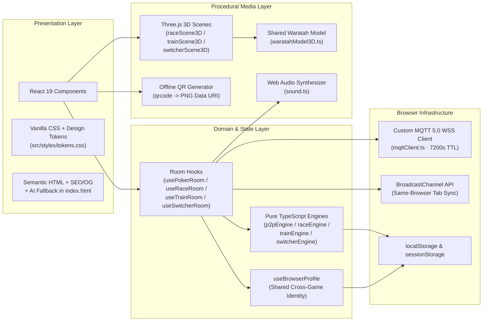
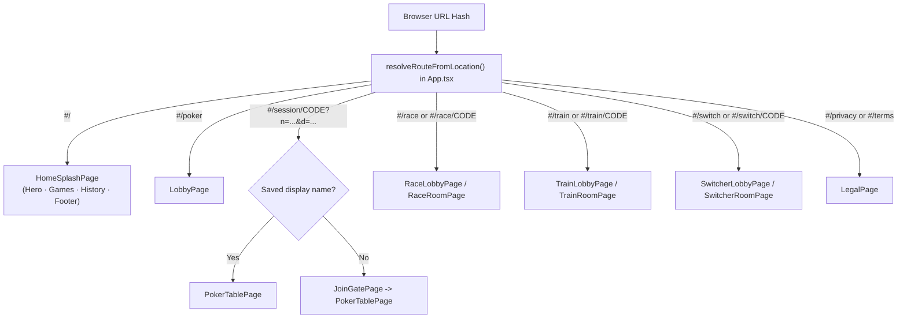

# Architecture & Tech Stack

[← Back to README](../README.md) · [Realtime Connectivity →](./REALTIME.md) · [Storage & State →](./STORAGE.md)

Estimateys is engineered as a **zero-backend, feature-sliced React SPA** where all rendering, 3D geometry, sound synthesis, QR generation, and conflict resolution run entirely inside the user's browser.

---

## 1. Tech Stack Layers



---

## 2. Feature-Sliced Codebase Layout

Code is organized **by domain feature** under `src/features/`, with cross-cutting UI, realtime transport, profile persistence, and utilities under `src/shared/`:

```text
src/
├── App.tsx                       # Hash router (#/, #/poker, #/session/:id, #/race, #/train, #/switch, #/privacy, #/terms)
├── styles/
│   ├── tokens.css                # Design tokens (emerald felt, brushed brass, typography, radii, shadows)
│   └── global.css                # Shared primitives (.panel, .panel--join, .btn, .brand, modals)
├── shared/
│   ├── api/sessionsApi.ts        # Room code generation & hash URL builders/parsers for all 4 games
│   ├── components/               # BrandLogo (🙌), SuiteNavbar, ProfileModal, SuiteFooter, ShareRoomModal, QrCodeButton, Modal, AdSlot
│   ├── config/monetization.ts    # Ko-fi & Google AdSense public config
│   ├── hooks/                    # useBrowserProfile (shared identity & histories), useToast
│   ├── realtime/mqttClient.ts    # Zero-dependency OASIS MQTT 5.0 over WSS client with LWT, 2h TTL & failover
│   ├── types/poker.ts            # Shared TypeScript domain contracts across all 4 games
│   └── utils/                    # sound.ts (Web Audio synth), linkify.tsx, roomSnapshotStorage.ts (10-room cap)
└── features/
    ├── home/                     # Full-viewport minimalistic HomeSplashPage (Hero -> Games -> History -> Footer)
    ├── cards/                    # Planning Poker decks (Fibonacci & T-Shirt) + physical 3D CSS flip cards
    ├── lobby/                    # Planning Poker Create/Join lobby + JoinGatePage
    ├── rounds/                   # RoundBanner, RoundModal, RoundHistoryDrawer
    ├── table/                    # p2pEngine.ts, usePokerRoom.ts, PokerTablePage, PokerTableArena
    ├── race/                     # raceEngine.ts, useRaceRoom.ts, raceScene3D.ts, 14 avatars, RaceLobby/Room
    ├── train/                    # waratahModel3D.ts (shared!), Sydney Express 3D & Track Switcher 3D
    └── legal/                    # Privacy Policy & Terms of Use pages
```

---

## 3. Hash Routing & Deep-Link Architecture

Because Estimateys is hosted statically (GitHub Pages / Netlify) and also supports single-file `index.html` delivery, all navigation uses **hash URLs** so deep links never return HTTP 404:



- **Invite links carry light metadata** (`?n=<Title>&d=<Deck>` or `?t=<Duration>`) so joining players immediately see the room name before the MQTT retained document arrives.
- **Offline QR Codes** ([`ShareRoomModal.tsx`](../src/shared/components/ShareRoomModal.tsx)) encode the full invite URL locally into a PNG data URI via `qrcode` with zero external API calls.

---

## 4. Shared Procedural 3D Pipeline (Zero External Assets)

All 3D games render via **Three.js** using 100% procedural geometries and canvas textures — eliminating `.glb`/`.gltf` downloads, CDN latency, and CORS issues:

- **Shared Waratah Model (`waratahModel3D.ts`)**: Both **Sydney Express 3D** and **Track Switcher 3D** import [`createWaratahTrain`](../src/features/train/waratahModel3D.ts) and [`createPlatformSignTexture`](../src/features/train/waratahModel3D.ts), keeping bundle growth minimal (~20 KB gzipped for both 3D train modes combined).
- **Procedural Fruit & Veggie Racers (`raceScene3D.ts`)**: 14 sculpted 3D characters (`8 fruits + 6 veggies`) with distinct cosmetic sprint animations driven by a deterministic race plan.
- **Clean WebGL Lifecycle**: Each 3D canvas component (`RaceCanvas3D`, `TrainCanvas3D`, `SwitcherCanvas3D`) owns a dedicated `ResizeObserver`, `requestAnimationFrame` loop, and full geometry/material/renderer disposal on unmount.

---

## 5. Build, Verification & Static Packaging

1. **Pure Engine Separation**: Every game's state transitions, deterministic Mulberry32 PRNG, merge rules, host failover selection, and parsers live in pure TypeScript modules (`p2pEngine.ts`, `raceEngine.ts`, `trainEngine.ts`, `switcherEngine.ts`) with zero DOM/React dependencies.
2. **Automated Verification (`npm test`)**: `test/verify.ts` executes directly on Node 22 and validates all 4 game engines, concurrent answer/vote merges, fairness distribution across random seeds, host failover, bulk bot parsing, link round-trips, referential stability, and offline QR PNG generation.
3. **Single-File Delivery (`dist-single/`)**: CSS and JS bundles from Vite can be inlined into a single standalone `index.html` (~1.15 MB uncompressed / ~303 KB gzipped) paired with `og-image.jpg`, `robots.txt`, `sitemap.xml`, `llms.txt`, and `ads.txt`.
