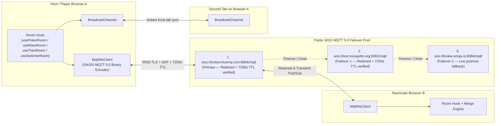
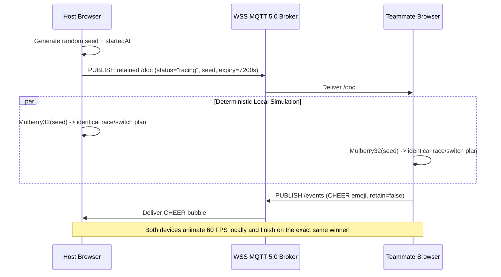
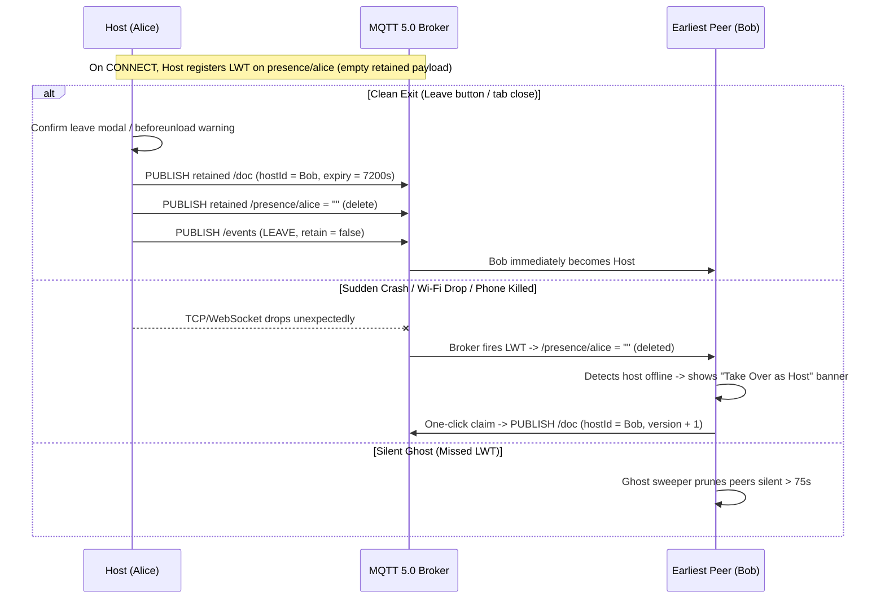
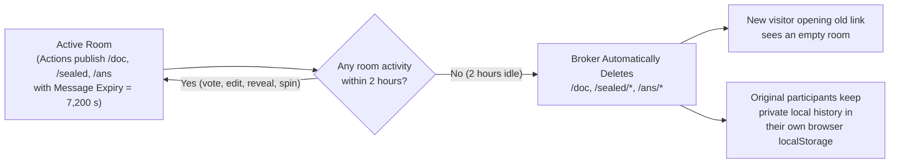

# Realtime Connectivity, 2-Hour Broker Expiry & Resilience

[← Back to README](../README.md) · [← Architecture](./ARCHITECTURE.md) · [Storage & State →](./STORAGE.md)

Estimateys provides live multiplayer synchronization across desktop and mobile devices **without any dedicated backend server or database**. It combines a custom **OASIS MQTT 5.0 over WebSocket** client with the browser's native **`BroadcastChannel` API**.

---

## 1. Dual-Channel Transport & Broker Failover

Every published update fans out simultaneously over:
1. **MQTT 5.0 over WSS** (`src/shared/realtime/mqttClient.ts`) for cross-device internet sync across teams, with automatic **2-hour `Message Expiry Interval`** (`7,200 s`).
2. **`BroadcastChannel`** for instant zero-latency sync between tabs in the same browser.

### Built-in Transport Safeguards (`mqttClient.ts`)
- **Zero Dependencies**: Implements raw OASIS MQTT 5.0 `CONNECT` (protocol level `0x05`), `CONNACK`, `SUBSCRIBE`, `PUBLISH` (with Property `0x02` `Message Expiry Interval`), `PINGREQ`, `PINGRESP`, and `DISCONNECT` binary framing directly over standard `WebSocket`.
- **Zombie-Socket Watchdog**: Sends `PINGREQ` keep-alives every `17 s` (`keepAliveSec = 25 s`) and forces a reconnect/failover if `PINGRESP` is missed (critical for mobile Safari backgrounding).
- **Foreground Wake Re-Sync**: Listens to `visibilitychange`, `focus`, `pageshow`, and `online` events to immediately call `refreshSync()` (re-subscribing to pull fresh retained broker state when returning from another app on iOS/Android).

---

## 2. MQTT Topic Architecture Across All 4 Games

Every room is isolated under a namespaced topic root keyed by its 6-character room code:

| Game | Topic Root | Retained Topics (Auto-Expire After 2h) | Transient Topics (Never Stored) |
| :--- | :--- | :--- | :--- |
| **Planning Poker** | `estimateys-planning/v1/<CODE>` | `/doc` (room & rounds) `/presence/<playerId>` `/sealed/<roundId>/<playerId>` | `/events` (`START_REVEAL_COUNTDOWN`, `DOC_EVENT`, `LEAVE`) |
| **Fruit Race 3D** | `estimateys-race/v1/<CODE>` | `/doc` (race config, seed, placements) `/presence/<playerId>` | `/events` (`CHEER`, `LEAVE`) |
| **Sydney Express 3D** | `estimateys-train/v1/<CODE>` | `/doc` (journey, stops, host) `/presence/<playerId>` `/ans/<journeyId>/<stopIdx>/<playerId>` | `/events` (`REACT`, `LEAVE`) |
| **Track Switcher 3D** | `estimateys-switch/v1/<CODE>` | `/doc` (options, seed, winner) `/presence/<playerId>` | `/events` (`CHEER`, `LEAVE`) |

### Why Per-Player Subtopics Matter
- **Conflict-Free Concurrent Writes**: In Planning Poker (`/sealed/<roundId>/<playerId>`) and Sydney Express (`/ans/<journeyId>/<stopIdx>/<playerId>`), every player publishes to **their own retained subtopic**. Ten teammates submitting at the exact same millisecond never overwrite each other.
- **Hidden Until Reveal**:
  - Planning Poker obfuscates sealed votes (`sealVote`) while `round.status === 'voting'` and only unfolds them into `doc.rounds[i].revealedVotes` when the synchronized 3-2-1 countdown hits zero.
  - Sydney Express keeps per-stop answers hidden in UI until the Conductor transitions `status` from `answering` → `revealed`, folding all live answers into the room document for history and latecomers.

---

## 3. Deterministic Synchronized 3D Playback

Instead of streaming 60 FPS positions over the network (which causes jitter and high bandwidth), **Fruit Race 3D** and **Track Switcher 3D** broadcast a single **random seed + start timestamp**:

---

## 4. Disconnect Handling, LWT & Automatic Host Failover

Every live room implements **four layers of disconnect protection**:

### Safeguard Summary
1. **Last Will & Testament (LWT)**: Registered at MQTT 5.0 `CONNECT` time (`willFlag = 1`, `willRetain = 1`) so if a browser crashes or loses power, the broker automatically deletes that player's retained `/presence/<playerId>` topic.
2. **bfcache-Safe `pagehide`**: Cleanly clears presence and triggers automatic host handover (`pickNextHost` / `pickNextTrainHost`) when closing a tab, while ignoring `evt.persisted === true` so iOS Safari back/forward cache doesn't falsely drop active players.
3. **Host Failover + Manual Takeover**: When a host exits cleanly, host controls transfer deterministically to the earliest-joined human peer (bots are excluded). If the host drops abruptly, teammates immediately see a **"Take Over as Host / Conductor / Signal Master"** banner (or after `32 s` of silence).
4. **Leave Warnings**: Native `beforeunload` prompt + in-app confirmation modal guard against accidental closes during active voting, racing, train travel, or track switching.

---

## 5. Data Retention, 2-Hour Broker Auto-Expiry & Scaling Path

Estimateys does **not** depend on any paid SaaS subscription, API key, or self-hosted backend. Instead, [`PUBLIC_MQTT_BROKERS`](../src/shared/realtime/mqttClient.ts) routes live traffic through free public MQTT 5.0 WebSocket brokers (`broker.hivemq.com`, `test.mosquitto.org`, `broker.emqx.io`).

### Exact Broker Data Lifecycle (2-Hour Auto-Expiry)

Every non-empty retained `PUBLISH` packet (`retain = true`) automatically stamps **MQTT 5.0 Property `0x02` (`Message Expiry Interval = 7200` seconds / 2 hours)**:

| Topic Type | `retain` | Broker Retention | Notes |
| :--- | :---: | :--- | :--- |
| **`/events`** *(cheers, countdowns, reactions, `LEAVE`)* | `false` | **0 seconds** (never stored) | Forwarded to live subscribers and discarded immediately. |
| **`/presence/<playerId>`** *(online status)* | `true` | **Until disconnect** (max 2h safety TTL) | Deleted immediately on Leave / `pagehide` or by LWT on crash; clients also ignore presence older than 2 hours. |
| **`/doc`**, **`/sealed/...`**, **`/ans/...`** *(room state, votes, replies)* | `true` | **Auto-deleted after 2 hours (`7,200 s`) of inactivity** | Every room update resets the 2-hour window. Empty `""` delete packets omit Property `0x02` so deletions apply immediately. |

### What This Means for Privacy & History
- **Sync window = 2 hours of inactivity**: While a team is actively playing (or up to 2 hours after the last update), anyone joining via URL or QR code receives the full current state from the broker.
- **After 2 hours, only participants have a private copy**: Once the broker expires the retained room messages, nothing remains on any public relay. Every participant who played still has their private game history saved locally in their browser (`localStorage`), including Planning Poker recent tables, Fruit Race 3D podiums, Sydney Express 3D Markdown exports, and Track Switcher 3D winners.
- **Resuming a Planning Poker table later**: Because original participants also keep a bounded local recovery snapshot (`estimateys_planning_room_<CODE>`), if an original participant re-opens a Planning Poker room link the next day, their browser restores it from their own `localStorage` and opens a fresh 2-hour live sync window for the team — while anyone who wasn't originally in the room cannot pull past data from the broker.

### Production Tradeoffs & 1-File Upgrade Path
| Aspect | Public MQTT 5.0 Relays | Mitigation in Estimateys |
| :--- | :--- | :--- |
| **Uptime / SLA** | Free community brokers have no formal SLA | 3-broker automatic failover (`HiveMQ → Mosquitto → EMQX`) + `PINGRESP` watchdog + local room snapshots |
| **Topic Namespace** | Shared public namespace keyed by 6-character room code | No accounts/passwords; votes obfuscated until reveal; strict **2-hour automatic broker deletion** |

Because all 4 games share the single [`MqttWsClient`](../src/shared/realtime/mqttClient.ts) abstraction, scaling to a private SLA-backed broker requires **zero changes to any game engine**:
- **Managed Serverless MQTT (Drop-In)**: Point `PUBLIC_MQTT_BROKERS` to a private **HiveMQ Cloud** or **EMQX Cloud Serverless** WSS endpoint (both support MQTT 5.0 `Message Expiry Interval` natively).
- **Edge WebSocket Alternative**: Swap the transport inside `mqttClient.ts` for **Cloudflare Workers + Durable Objects** if you later want server-side room auth or custom quotas.
