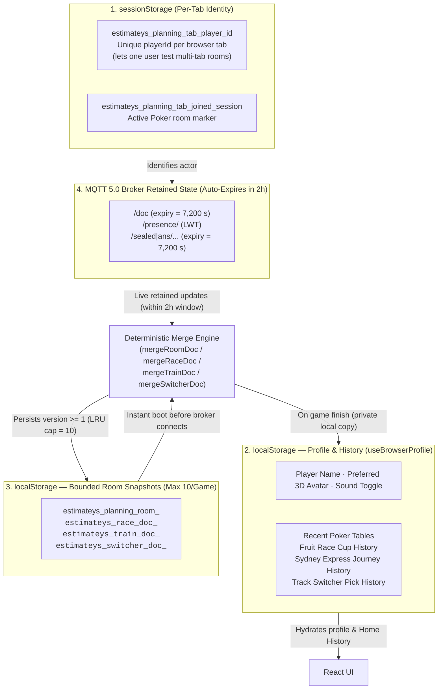
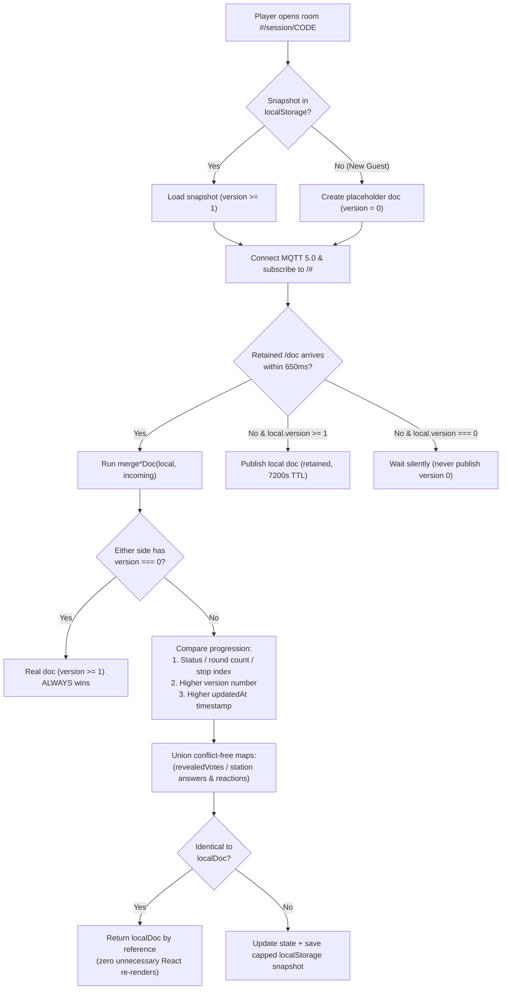

# Client-Side Storage & State Synchronization

[← Back to README](../README.md) · [← Architecture](./ARCHITECTURE.md) · [← Realtime Connectivity](./REALTIME.md)

Estimateys stores **zero user data in any central database**. All player identity, preferences, recent rooms, and completed game histories live strictly inside each user's own browser, synchronized with transient/retained room documents only while playing.

---

## 1. Four-Tier State & Storage Model

---

## 2. Complete Browser Storage Key Inventory

### `sessionStorage` (Isolated Per Browser Tab)

| Key | Purpose |
| :--- | :--- |
| `estimateys_planning_tab_player_id` | Randomly generated `plr_<uuid>` unique to the current tab so opening two tabs simulates two distinct teammates cleanly. |
| `estimateys_planning_tab_joined_session` | Tracks the currently joined Planning Poker table in this tab. |

### `localStorage` (Persisted Across Reloads & Shared Across All 4 Games)

Managed centrally by [`useBrowserProfile.ts`](../src/shared/hooks/useBrowserProfile.ts) and editable anytime from the top-right **Playing as …** button (`ProfileModal.tsx`):

| Key | Type | Retention Cap | Purpose |
| :--- | :--- | :--- | :--- |
| `estimateys_planning_player_name` | `string` | Single value (max 40 chars) | Shared display name across all 4 games. |
| `estimateys_preferred_avatar` | `FruitAvatarId` | Single value (1 of 14) | Selected fruit/veggie 3D avatar shown in navbar & pre-selected in Fruit Race 3D. |
| `estimateys_planning_sound_enabled` | `'true' \| 'false'` | Single value | Global Web Audio mute/unmute toggle. |
| `estimateys_planning_recent_sessions` | `RecentSessionRecord[]` | Last **6** tables | Recent Planning Poker tables for one-click re-entry. |
| `estimateys_race_history` | `RaceHistoryEntry[]` | Last **30** cups | Completed Fruit Race 3D cups with full 1st/2nd/3rd+ podium placements. |
| `estimateys_train_history` | `TrainHistoryEntry[]` | Last **25** journeys | Completed Sydney Express 3D journeys with all station prompts and team replies. |
| `estimateys_switcher_history` | `SwitcherHistoryEntry[]` | Last **30** picks | Completed Track Switcher 3D spins with winning Sydney T-line badge and label. |

### `localStorage` — Bounded Per-Room Recovery Snapshots (Max 10 Rooms Per Game)

Managed by [`roomSnapshotStorage.ts`](../src/shared/utils/roomSnapshotStorage.ts) — whenever a room snapshot is saved, if more than **10** snapshots exist for that game's prefix, the oldest snapshots (by `updatedAt`) are automatically pruned so `localStorage` stays compact:

| Key Pattern | Owner Module | Cap | Purpose |
| :--- | :--- | :--- | :--- |
| `estimateys_planning_room_<CODE>` | [`p2pEngine.ts`](../src/features/table/p2pEngine.ts) | 10 rooms | Last known `RoomDoc` (rounds, deck, revealed votes) for instant reload recovery & next-day resume. |
| `estimateys_race_doc_<CODE>` | [`raceEngine.ts`](../src/features/race/raceEngine.ts) | 10 rooms | Last known `RaceRoomDoc` (racers, bots, duration, seed, placements). |
| `estimateys_train_doc_<CODE>` | [`trainEngine.ts`](../src/features/train/trainEngine.ts) | 10 rooms | Last known `TrainRoomDoc` (deck, stops, answers, host). |
| `estimateys_switcher_doc_<CODE>` | [`switcherEngine.ts`](../src/features/train/switcherEngine.ts) | 10 rooms | Last known `SwitcherRoomDoc` (options, elimination mode, winner). |

---

## 3. Anti-Clobbering Merge & Version-0 Protocol

Because there is no central database lock, joining guests could accidentally overwrite an active room if they published an empty initial state on connect. Estimateys prevents this with a strict **Version-0 Placeholder + Delayed Initial Publish** protocol:

### Key Guarantees
- **2-Hour Ephemeral Broker, Private Local History**: The MQTT 5.0 broker automatically deletes room topics after 2 hours (`7,200 s`) of inactivity. Only the participants who were in the room keep private copies in their browser's `localStorage` history.
- **Version-0 Guests Never Clobber Active Rooms**: `publishDoc` only publishes when `doc.version > 0`, and every `merge*Doc` function unconditionally yields `version === 0` to any `version >= 1` document.
- **Bounded Storage Footprint**: History arrays are capped (`6 / 30 / 25 / 30`) and per-room recovery snapshots are LRU-pruned to the `10` most recent rooms per game.
- **Referential Stability on No-Op Syncs**: When periodic foreground `refreshSync()` re-delivers an identical retained `RoomDoc`, `mergeRoomDoc` returns `localDoc` by exact reference (and unchanged presence heartbeats keep the existing `peers` `Map`), preventing UI flicker or modal input resets.
- **Graceful Quota / Private Mode Fallback**: Every `localStorage` / `sessionStorage` read and write is wrapped in `try/catch` so strict private-browsing modes continue working in memory without crashing.
